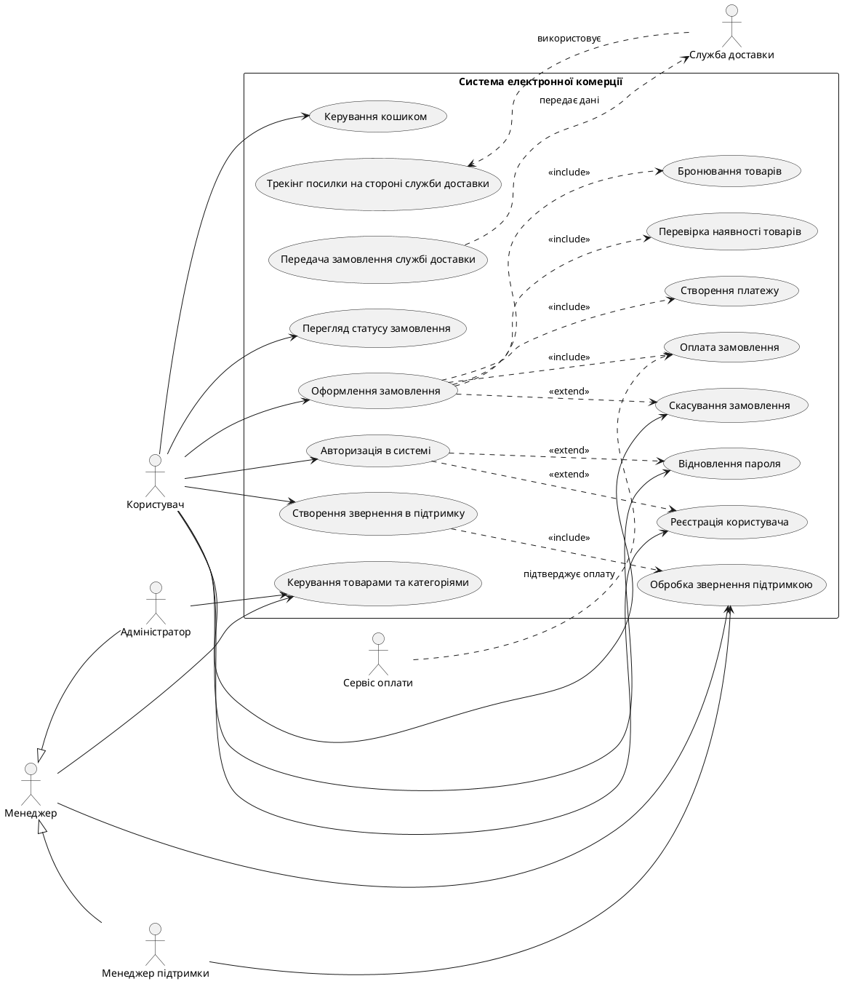

# Use Case Diagram for the E-commerce System

## Аналіз відповідності ER-діаграмі та ADR

ER-діаграма описує основні сутності системи:
- User
- Address
- Cart / Cart_Item
- Product / Category
- Order / Order_Item
- Payment
- Support_Message
- Manager

Ці сутності визначають основні сценарії використання:
- реєстрація та авторизація користувача
- робота з кошиком і оформлення замовлення
- оплата та статус замовлення
- підтримка користувача
- управління товарами та категоріями
- передача замовлення службі доставки

У відповідності до ADR-0003 базовий актор Manager має спеціалізації:
- Manager Support
- Administrator

Також ADR-0001 визначає, що служба доставки є зовнішнім актором, який лише отримує інформацію про замовлення, але не змінює дані в системі напряму.

## UML Use Case Diagram

## Опис основних use case

### 1. Реєстрація користувача
- Користувач вводить email, пароль та контактні дані.
- Система перевіряє унікальність email та зберігає дані користувача.
- Після успішної реєстрації користувач отримує доступ до системи.

### 2. Авторизація в системі
- Користувач може увійти через email/password або Google SSO.
- Система перевіряє облікові дані та створює сесію користувача.
- Авторизація може бути розширена сценарієм відновлення пароля.

### 3. Відновлення пароля
- Користувач вводить email для відновлення доступу.
- Система надсилає посилання або код підтвердження.
- Після підтвердження користувач встановлює новий пароль.

### 4. Керування кошиком
- Користувач може додавати, видаляти та змінювати кількість товарів у кошику.
- Система оновлює загальну вартість замовлення.
- Кошик пов'язаний з користувачем через сутність CART.

### 5. Оформлення замовлення
- Користувач вибирає товари з кошика.
- Система перевіряє наявність товарів, бронює їх та створює замовлення.
- Після цього ініціюється процес оплати.

### 6. Оплата замовлення
- Система передає дані до сервісу оплати.
- Сервіс оплати підтверджує або відхиляє платіж.
- Якщо платіж не пройшов, система скасовує замовлення або повертає його в попередній стан.

### 7. Скасування замовлення
- Користувач може скасувати замовлення до моменту відправлення.
- Система змінює статус замовлення та повертає зарезервовані товари на склад.

### 8. Перегляд статусу замовлення
- Користувач може переглядати статус замовлення, історію покупок та деталі оплати.
- Система відображає актуальну інформацію з сутностей ORDER та PAYMENT.

### 9. Створення звернення в підтримку
- Користувач створює заявку з питанням або проблемою.
- Система зберігає звернення та присвоює статус "open".
- Після прийняття менеджером підтримки звернення обробляється.

### 10. Обробка звернення підтримкою
- Менеджер підтримки або базовий Менеджер може переглядати список звернень.
- Менеджер може змінювати статус звернення та відповідати користувачу.
- Після завершення питання звернення закривається.

### 11. Керування товарами та категоріями
- Адміністратор або менеджер відповідає за управління товарним каталогом.
- Ця роль пов'язана із сутністю PRODUCT і CATEGORY в ER-діаграмі.

### 12. Передача замовлення службі доставки
- Після успішної оплати система передає замовлення службі доставки.
- Служба доставки отримує дані про замовлення і адресу одержувача.
- Подальше відстеження посилки виконується на стороні служби доставки.

## Зв'язки include / extend

### Include
- Оформлення замовлення включає перевірку наявності товарів.
- Оформлення замовлення включає бронювання товарів.
- Оформлення замовлення включає створення платежу.
- Створення звернення включає його обробку менеджером.

### Extend
- Авторизація розширюється сценарієм відновлення пароля.
- Оформлення замовлення може бути розширене сценарієм скасування замовлення.

## Висновок

Уточнена UML-діаграма відповідає прийнятому рішенню:
- базовий актоp Manager має спеціалізації SupportManager та Administrator;
- служба доставки є зовнішнім актором, який отримує дані про замовлення, але не має прямого доступу до змінення даних системи;
- поточна діаграма узгоджується з ER-моделлю та ADR-рішеннями 0001 і 0003.
