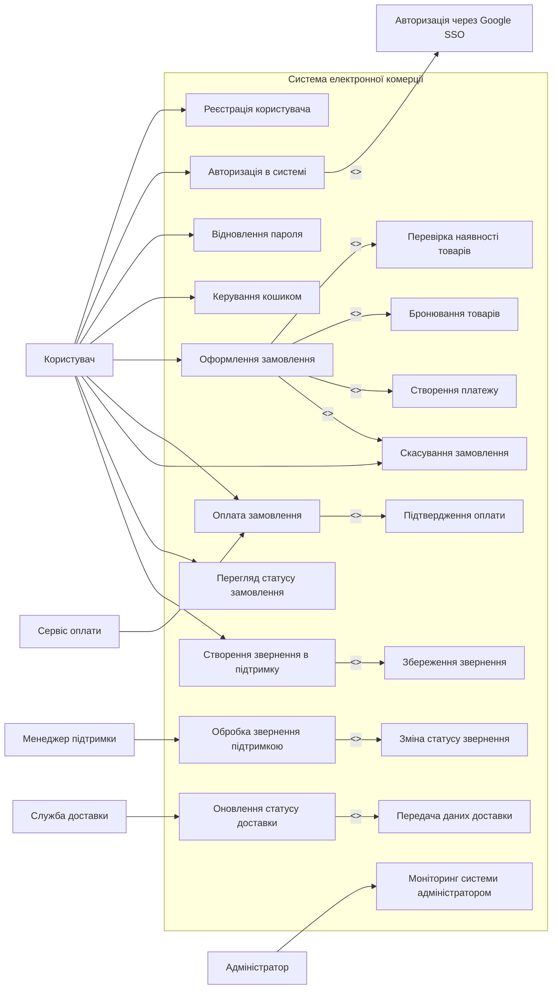

# Use Case Diagram for the E-commerce System

## Аналіз відповідності ER-діаграмі

ER-діаграма описує такі ключові сутності:
- User
- Address
- Cart / Cart_Item
- Product / Category
- Order / Order_Item
- Payment
- Support_Message
- Manager

З цього випливає, що основні use cases повинні охоплювати:
- авторизацію та управління профілем користувача
- роботу з кошиком і товарами
- оформлення та оплату замовлення
- відстеження доставки
- підтримку користувача
- управління системою адміністратором

## Use Case Diagram

## Опис основних use cases

### 1. Реєстрація користувача
- Користувач вводить email, пароль та контактні дані.
- Система перевіряє унікальність email та зберігає дані користувача.
- Якщо введені дані коректні, користувач отримує доступ до системи.

### 2. Авторизація в системі
- Користувач може увійти через email/password або Google SSO.
- Система перевіряє облікові дані та створює сесію користувача.
- Якщо користувач неавторизований, він не може оформити замовлення або створити звернення.

### 3. Відновлення пароля
- Користувач вводить email для відновлення доступу.
- Система надсилає посилання або код підтвердження.
- Після підтвердження новий пароль зберігається у захищеному вигляді.

### 4. Керування кошиком
- Користувач може додати, видалити та змінити кількість товарів.
- Система перевіряє наявність товарів і оновлює загальну суму кошика.
- Кошик пов'язаний з користувачем через сутність CART.

### 5. Оформлення замовлення
- Користувач вибирає товари з кошика.
- Система перевіряє наявність товарів на складі.
- Якщо товари доступні, система бронює їх і створює замовлення.
- Замовлення прив'язується до користувача та адреси доставки.

### 6. Оплата замовлення
- Після оформлення замовлення система передає дані до сервісу оплати.
- Сервіс оплати підтверджує або відхиляє платіж.
- У разі відхилення система змінює статус платежу та скасовує замовлення.

### 7. Скасування замовлення
- Користувач може скасувати замовлення до відправлення.
- Система оновлює статус замовлення та повертає зарезервовані товари на склад.

### 8. Перегляд статусу замовлення
- Користувач може переглядати історію покупок, поточний статус та інформацію про оплату.
- Система відображає інформацію, що відповідає сутностям ORDER і PAYMENT.

### 9. Створення звернення в підтримку
- Користувач формулює запит або проблему.
- Система створює запис SUPPORT_MESSAGE з статусом open.
- Після прийняття менеджером звернення статус змінюється.

### 10. Обробка звернення підтримкою
- Менеджер переглядає список звернень.
- Він може змінювати статус на in progress, resolved або closed.
- Користувач отримує відповідь на свою заявку.

### 11. Оновлення статусу доставки
- Служба доставки отримує замовлення та адресні дані.
- Вона оновлює статус замовлення залежно від етапу доставки.
- Користувач отримує інформацію про номер накладної та статус посилки.

### 12. Моніторинг системи адміністратором
- Адміністратор переглядає замовлення, користувачів, звернення та статистику роботи системи.
- Якщо виникають проблеми або перевищення навантаження, адміністратор отримує інформацію для реакції.

## Зв'язки include / extend

### Include
- Оформлення замовлення включає перевірку наявності товарів.
- Оформлення замовлення включає бронювання товарів.
- Оформлення замовлення включає створення платежу.
- Створення звернення включає збереження повідомлення.
- Обробка звернення включає зміну статусу звернення.
- Оновлення статусу доставки включає передачу даних до служби доставки.

### Extend
- Авторизація може бути розширена сценарієм авторизації через Google SSO.
- Оформлення замовлення розширюється сценарієм скасування замовлення при відмові в оплаті або недоступності товару.

## Висновок

Use case діаграма охоплює основні бізнес-процеси системи, що відображаються в ER-діаграмі:
- користувач взаємодіє з кошиком, замовленнями, оплатою та підтримкою;
- менеджер, служба доставки та адміністратор виконують окремі ролі;
- система підтримує компоненти, які безпосередньо відповідають моделям даних: User, Product, Cart, Order, Payment, Address, Support_Message.

Таким чином, діаграма повністю узгоджується з вимогами та структурою даних проєкту.
