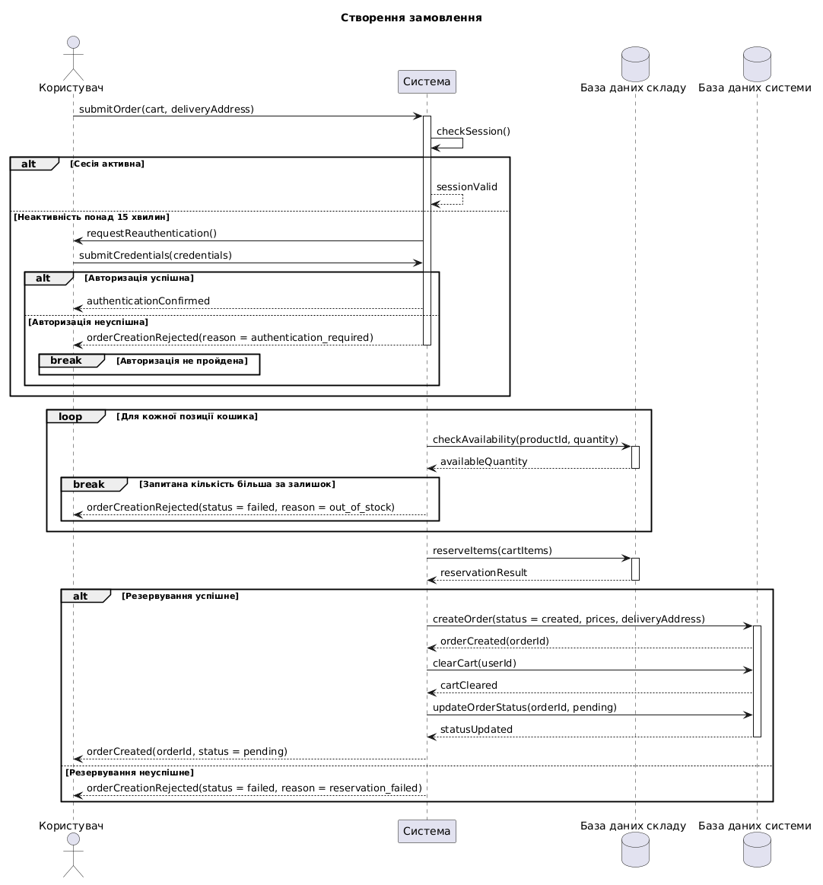

@startuml
title Створення замовлення

actor "Користувач" as User
participant "Система" as System
database "База даних складу" as Inventory
database "База даних системи" as Database

User -> System : submitOrder(cart, deliveryAddress)
activate System
System -> System : checkSession()

alt Сесія активна
    System --> System : sessionValid
else Неактивність понад 15 хвилин
    System -> User : requestReauthentication()
    User -> System : submitCredentials(credentials)
    alt Авторизація успішна
        System --> User : authenticationConfirmed
    else Авторизація неуспішна
        System --> User : orderCreationRejected(reason = authentication_required)
        deactivate System
        break Авторизація не пройдена
        end
    end
end

loop Для кожної позиції кошика
    System -> Inventory : checkAvailability(productId, quantity)
    activate Inventory
    Inventory --> System : availableQuantity
    deactivate Inventory

    break Запитана кількість більша за залишок
        System --> User : orderCreationRejected(status = failed, reason = out_of_stock)
        deactivate System
    end
end

System -> Inventory : reserveItems(cartItems)
activate Inventory
Inventory --> System : reservationResult
deactivate Inventory

alt Резервування успішне
    System -> Database : createOrder(status = created, prices, deliveryAddress)
    activate Database
    Database --> System : orderCreated(orderId)
    System -> Database : clearCart(userId)
    Database --> System : cartCleared
    System -> Database : updateOrderStatus(orderId, pending)
    Database --> System : statusUpdated
    deactivate Database
    System --> User : orderCreated(orderId, status = pending)
else Резервування неуспішне
    System --> User : orderCreationRejected(status = failed, reason = reservation_failed)
end

deactivate System
@enduml

