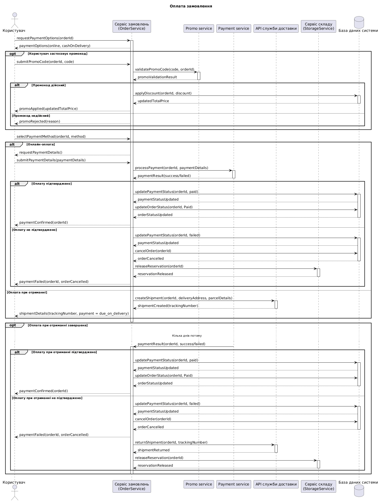

@startuml
title Оплата замовлення

actor "Користувач" as User
participant "Сервіс замовлень\n(OrderService)" as OrderService
participant "Promo service" as Promo
participant "Payment service" as Payment
participant "API служби доставки" as Delivery
participant "Сервіс складу\n(StorageService)" as StorageService
database "База даних системи" as Database

User -> OrderService : requestPaymentOptions(orderId)
activate OrderService
OrderService --> User : paymentOptions(online, cashOnDelivery)

opt Користувач застосовує промокод
    User -> OrderService : submitPromoCode(orderId, code)
    OrderService -> Promo : validatePromoCode(code, orderId)
    activate Promo
    Promo --> OrderService : promoValidationResult
    deactivate Promo

    alt Промокод дійсний
        OrderService -> Database : applyDiscount(orderId, discount)
        activate Database
        Database --> OrderService : updatedTotalPrice
        deactivate Database
        OrderService --> User : promoApplied(updatedTotalPrice)
    else Промокод недійсний
        OrderService --> User : promoRejected(reason)
    end
end

User -> OrderService : selectPaymentMethod(orderId, method)

alt Онлайн-оплата
    OrderService --> User : requestPaymentDetails()
    User -> OrderService : submitPaymentDetails(paymentDetails)
    OrderService -> Payment : processPayment(orderId, paymentDetails)
    activate Payment
    Payment --> OrderService : paymentResult(success/failed)
    deactivate Payment

    alt Оплату підтверджено
        OrderService -> Database : updatePaymentStatus(orderId, paid)
        activate Database
        Database --> OrderService : paymentStatusUpdated
        OrderService -> Database : updateOrderStatus(orderId, Paid)
        Database --> OrderService : orderStatusUpdated
        deactivate Database
        OrderService --> User : paymentConfirmed(orderId)
    else Оплату не підтверджено
        OrderService -> Database : updatePaymentStatus(orderId, failed)
        activate Database
        Database --> OrderService : paymentStatusUpdated
        OrderService -> Database : cancelOrder(orderId)
        Database --> OrderService : orderCancelled
        deactivate Database

        OrderService -> StorageService : releaseReservation(orderId)
        activate StorageService
        StorageService --> OrderService : reservationReleased
        deactivate StorageService
        OrderService --> User : paymentFailed(orderId, orderCancelled)
    end

else Оплата при отриманні
    OrderService -> Delivery : createShipment(orderId, deliveryAddress, parcelDetails)
    activate Delivery
    Delivery --> OrderService : shipmentCreated(trackingNumber)
    deactivate Delivery
    OrderService --> User : shipmentDetails(trackingNumber, payment = due_on_delivery)
end

deactivate OrderService

opt Оплата при отриманні завершена
    ... Кілька днів потому ...
    Payment -> OrderService : paymentResult(orderId, success/failed)
    activate OrderService

    alt Оплату при отриманні підтверджено
        OrderService -> Database : updatePaymentStatus(orderId, paid)
        activate Database
        Database --> OrderService : paymentStatusUpdated
        OrderService -> Database : updateOrderStatus(orderId, Paid)
        Database --> OrderService : orderStatusUpdated
        deactivate Database
        OrderService --> User : paymentConfirmed(orderId)
    else Оплату при отриманні не підтверджено
        OrderService -> Database : updatePaymentStatus(orderId, failed)
        activate Database
        Database --> OrderService : paymentStatusUpdated
        OrderService -> Database : cancelOrder(orderId)
        Database --> OrderService : orderCancelled
        deactivate Database
        OrderService --> User : paymentFailed(orderId, orderCancelled)

        OrderService -> Delivery : returnShipment(orderId, trackingNumber)
        activate Delivery
        Delivery --> OrderService : shipmentReturned
        deactivate Delivery
        OrderService -> StorageService : releaseReservation(orderId)
        activate StorageService
        StorageService --> OrderService : reservationReleased
        deactivate StorageService
    end

    deactivate OrderService
end
@enduml
