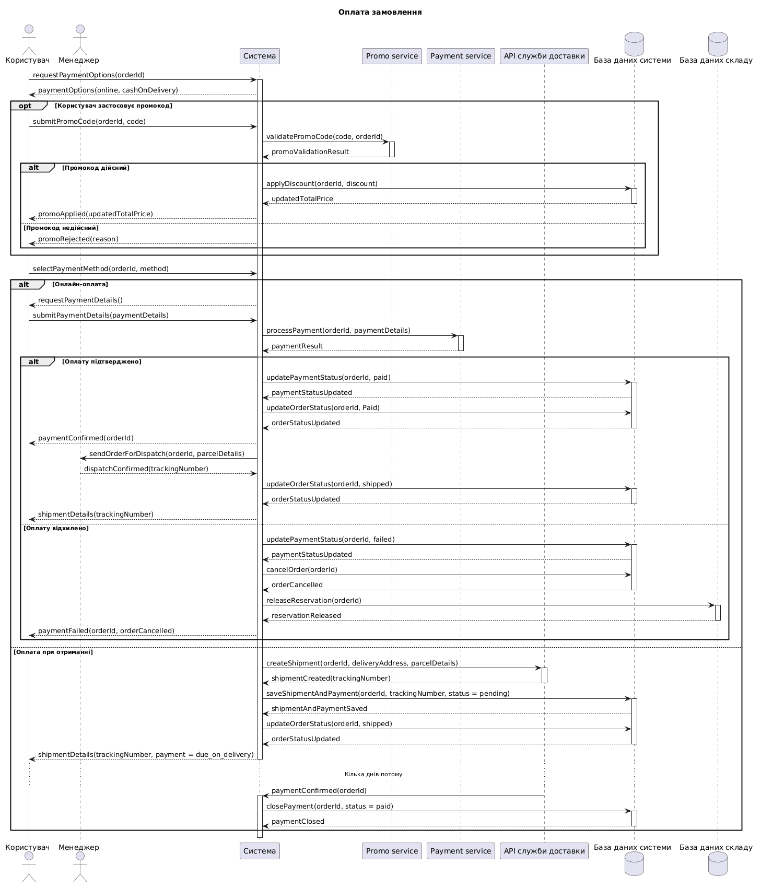

@startuml
title Оплата замовлення

actor "Користувач" as User
actor "Менеджер" as Manager
participant "Система" as System
participant "Promo service" as Promo
participant "Payment service" as Payment
participant "API служби доставки" as Delivery
database "База даних системи" as Database
database "База даних складу" as Inventory

User -> System : requestPaymentOptions(orderId)
activate System
System --> User : paymentOptions(online, cashOnDelivery)

opt Користувач застосовує промокод
    User -> System : submitPromoCode(orderId, code)
    System -> Promo : validatePromoCode(code, orderId)
    activate Promo
    Promo --> System : promoValidationResult
    deactivate Promo

    alt Промокод дійсний
        System -> Database : applyDiscount(orderId, discount)
        activate Database
        Database --> System : updatedTotalPrice
        deactivate Database
        System --> User : promoApplied(updatedTotalPrice)
    else Промокод недійсний
        System --> User : promoRejected(reason)
    end
end

User -> System : selectPaymentMethod(orderId, method)

alt Онлайн-оплата
    System --> User : requestPaymentDetails()
    User -> System : submitPaymentDetails(paymentDetails)
    System -> Payment : processPayment(orderId, paymentDetails)
    activate Payment
    Payment --> System : paymentResult
    deactivate Payment

    alt Оплату підтверджено
        System -> Database : updatePaymentStatus(orderId, paid)
        activate Database
        Database --> System : paymentStatusUpdated
        System -> Database : updateOrderStatus(orderId, Paid)
        Database --> System : orderStatusUpdated
        deactivate Database
        System --> User : paymentConfirmed(orderId)

        System -> Manager : sendOrderForDispatch(orderId, parcelDetails)
        Manager --> System : dispatchConfirmed(trackingNumber)
        System -> Database : updateOrderStatus(orderId, shipped)
        activate Database
        Database --> System : orderStatusUpdated
        deactivate Database
        System --> User : shipmentDetails(trackingNumber)
    else Оплату відхилено
        System -> Database : updatePaymentStatus(orderId, failed)
        activate Database
        Database --> System : paymentStatusUpdated
        System -> Database : cancelOrder(orderId)
        Database --> System : orderCancelled
        deactivate Database
        System -> Inventory : releaseReservation(orderId)
        activate Inventory
        Inventory --> System : reservationReleased
        deactivate Inventory
        System --> User : paymentFailed(orderId, orderCancelled)
    end

else Оплата при отриманні
    System -> Delivery : createShipment(orderId, deliveryAddress, parcelDetails)
    activate Delivery
    Delivery --> System : shipmentCreated(trackingNumber)
    deactivate Delivery
    System -> Database : saveShipmentAndPayment(orderId, trackingNumber, status = pending)
    activate Database
    Database --> System : shipmentAndPaymentSaved
    System -> Database : updateOrderStatus(orderId, shipped)
    Database --> System : orderStatusUpdated
    deactivate Database
    System --> User : shipmentDetails(trackingNumber, payment = due_on_delivery)

    deactivate System
    ... Кілька днів потому ...
    Delivery -> System : paymentConfirmed(orderId)
    activate System
    System -> Database : closePayment(orderId, status = paid)
    activate Database
    Database --> System : paymentClosed
    deactivate Database
end

deactivate System
@enduml

