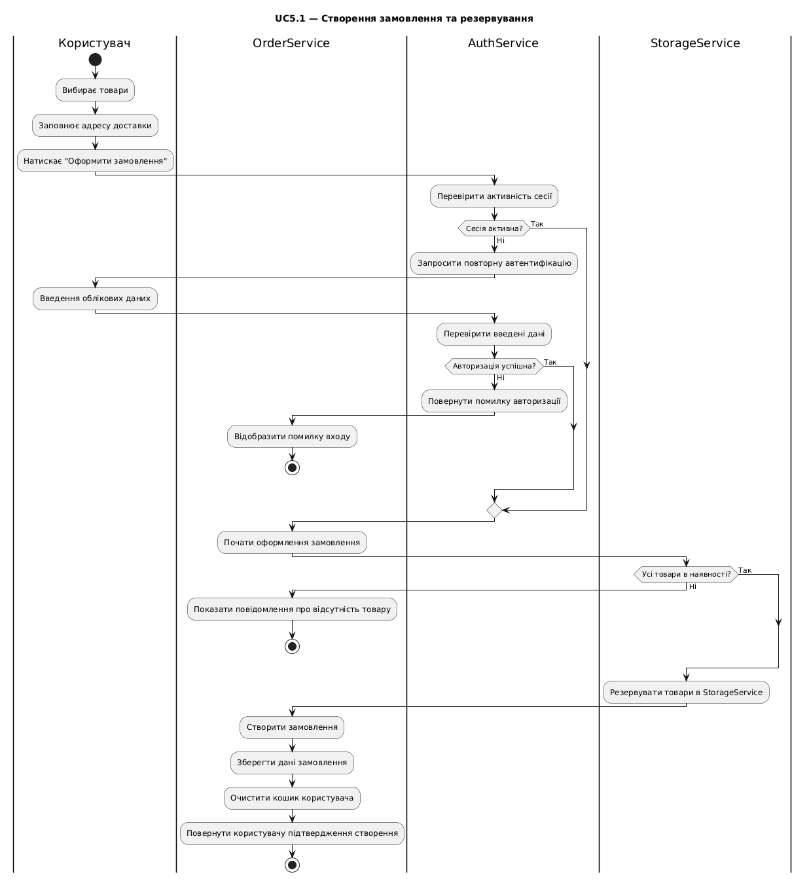

# Activity-діаграма: оформлення та оплата замовлення
@startuml
title UC5.1 — Створення замовлення та резервування

|Користувач|
|OrderService|
|AuthService|
|StorageService|

|Користувач|
start
:Вибирає товари;
:Заповнює адресу доставки;
:Натискає "Оформити замовлення";

|AuthService|
:Перевірити активність сесії;
if (Сесія активна?) then (Так)
else (Ні)
    :Запросити повторну автентифікацію;
    |Користувач|
    :Введення облікових даних;
    |AuthService|
    :Перевірити введені дані;
    if (Авторизація успішна?) then (Так)
    else (Ні)
        :Повернути помилку авторизації;
        |OrderService|
        :Відобразити помилку входу;
        stop
    endif
endif

|OrderService|
:Почати оформлення замовлення;
|StorageService|
if (Усі товари в наявності?) then (Так)
else (Ні)
    |OrderService|
    :Показати повідомлення про відсутність товару;
    stop
endif

|StorageService|
:Резервувати товари в StorageService;

|OrderService|
:Створити замовлення;
:Зберегти дані замовлення;
:Очистити кошик користувача;
:Повернути користувачу підтвердження створення;
stop

@enduml

