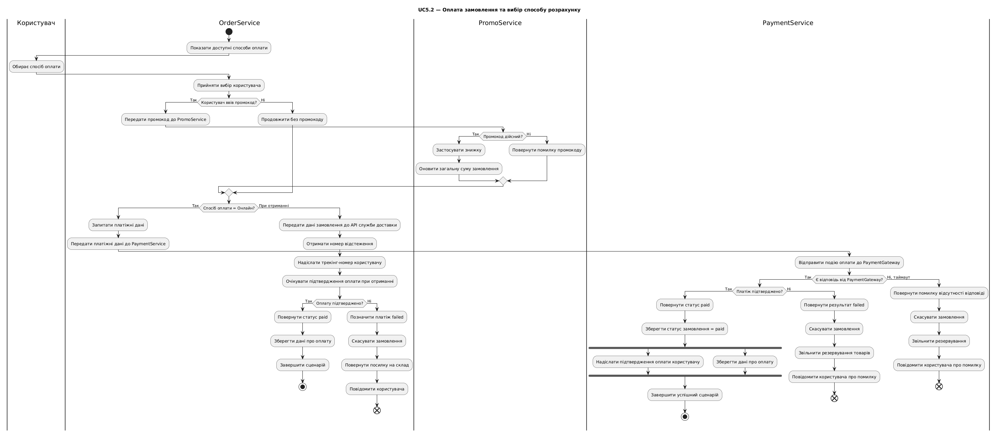

@startuml
title UC5.2 — Оплата замовлення та вибір способу розрахунку

|Користувач|
|OrderService|
|PromoService|
|PaymentService|

|OrderService|
start
:Показати доступні способи оплати;

|Користувач|
:Обирає спосіб оплати;

|OrderService|
:Прийняти вибір користувача;
if (Користувач ввів промокод?) then (Так)
    :Передати промокод до PromoService;
    |PromoService|
    if (Промокод дійсний?) then (Так)
        :Застосувати знижку;
        :Оновити загальну суму замовлення;
    else (Ні)
        :Повернути помилку промокоду;
    endif
else (Ні)
    |OrderService|
    :Продовжити без промокоду;
endif

|OrderService|
if (Спосіб оплати = Онлайн?) then (Так)
    :Запитати платіжні дані;
    :Передати платіжні дані до PaymentService;
    |PaymentService|
    :Відправити подію оплати до PaymentGateway;
    if (Є відповідь від PaymentGateway?) then (Так)
        if (Платіж підтверджено?) then (Так)
            :Повернути статус paid;
            :Зберегти статус замовлення = paid;
            fork
                :Надіслати підтвердження оплати користувачу;
            fork again
                :Зберегти дані про оплату;
            end fork
            :Завершити успішний сценарій;
            stop
        else (Ні)
            :Повернути результат failed;
            :Скасувати замовлення;
            :Звільнити резервування товарів;
            :Повідомити користувача про помилку;
            end
        endif
    else (Ні, таймаут)
        :Повернути помилку відсутності відповіді;
        :Скасувати замовлення;
        :Звільнити резервування;
        :Повідомити користувача про помилку;
        end
    endif
else (При отриманні)
    |OrderService|
    :Передати дані замовлення до API служби доставки;
    :Отримати номер відстеження;
    :Надіслати трекінг-номер користувачу;
    :Очікувати підтвердження оплати при отриманні;
    if (Оплату підтверджено?) then (Так)
        :Повернути статус paid;
        :Зберегти дані про оплату;
        :Завершити сценарій;
        stop
    else (Ні)
        :Позначити платіж failed;
        :Скасувати замовлення;
        :Повернути посилку на склад;
        :Повідомити користувача;
        end
    endif
endif

@enduml

