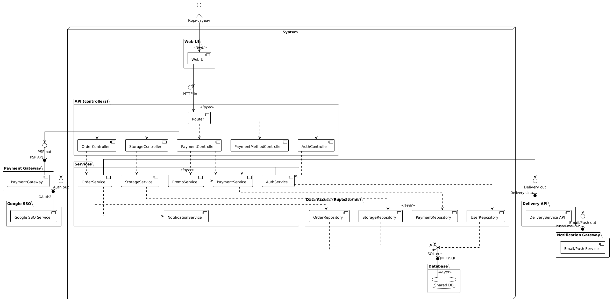

## Діаграма компонентів
@startuml
!theme plain
skinparam componentStyle uml2
skinparam linetype ortho

' Налаштування стилів для кращої візуалізації
skinparam Package {
    BackgroundColor<<layer>> #F9F9F9
    BorderColor<<layer>> #A0A0A0
}

' Користувач
actor "Користувач" as User

' Зовнішні інтеграції (поза System, не об'єднані в один пакет)
package "Google SSO" {
    [Google SSO Service] as GoogleSSO
}
package "Delivery API" {
    [DeliveryService API] as DeliveryAPI
}
package "Notification Gateway" {
    [Email/Push Service] as EmailPush
}
package "Payment Gateway" {
    [PaymentGateway] as PaymentGW
}

' МЕЖІ СИСТЕМИ
node "System" {

    ' Шари Web UI та API
    package "Web UI" <<layer>> {
        [Web UI] as WebUI
    }

    ' Вхідний порт (lollipop Rest API)
    () "HTTP in" as HTTP_In

    package "API (controllers)" <<layer>> {
        [Router] as Router
        [AuthController] as AuthController
        [PaymentMethodController] as PMController
        [PaymentController] as PaymentController
        [StorageController] as StorageController
        [OrderController] as OrderController
    }

    ' Шар Services
    package "Services" <<layer>> {
        [AuthService] as AuthService
        [OrderService] as OrderService
        [StorageService] as StorageService
        [PromoService] as PromoService
        [PaymentService] as PaymentService
        [NotificationService] as NotificationService
    }

    ' Шар Data Access
    package "Data Access (Repositories)" <<layer>> {
        [UserRepository] as UserRepository
        [OrderRepository] as OrderRepository
        [StorageRepository] as StorageRepository
        [PaymentRepository] as PaymentRepository
    }

    ' База даних
    package "Database" <<layer>> {
        database "Shared DB" as DB
    }
    
    ' Вихідний порт для БД
    () "SQL out" as SQL_Out
}

' Інтерфейси/Порти (Лоліпопи) на межі системи
() "Auth out" as Auth_Out
() "Delivery out" as Delivery_Out
() "Email/Push out" as EmailPush_Out
() "PSP out" as PSP_Out

' -----------------------------------------------------------------
' Зв'язки та логіка (Потоки зверху вниз)
' -----------------------------------------------------------------

' Користувач -> Web UI
User -down-> WebUI

' Web UI -> HTTP In -> Router
WebUI -down-> HTTP_In
HTTP_In -down-> Router

' Зв'язки всередині API (зв'язки від Router до контролерів)
Router .down.> AuthController
Router .down.> OrderController
Router .down.> StorageController
Router .down.> PaymentController
Router .down.> PMController

' 1. Auth потік
AuthController .down.> AuthService
AuthService .down.> UserRepository
' Auth -> Google SSO (Lollipop)
AuthService -left-> Auth_Out
Auth_Out -(0- GoogleSSO : OAuth2

' 2. Order потік
OrderController .down.> OrderService
OrderService .down.> OrderRepository
OrderService .down.> NotificationService
' Order -> Delivery API (Lollipop)
OrderService -right-> Delivery_Out
Delivery_Out -(0- DeliveryAPI : Delivery data

' 3. Notification потік
NotificationService -right-> EmailPush_Out
EmailPush_Out -(0- EmailPush : Push/Email API

' 4. Storage потік
StorageController .down.> StorageService
StorageService .down.> StorageRepository

' 5. Payment & Promo потік
PMController .down.> PaymentService
PaymentController .down.> PromoService
PaymentController .down.> PaymentService
PromoService .right.> PaymentService
PaymentService .down.> PaymentRepository
' Payment -> Payment Gateway (Lollipop)
PaymentController -left-> PSP_Out
PSP_Out -(0- PaymentGW : PSP API

' 6. Доступ до БД через порт SQL out (lollipop)
UserRepository .down.> SQL_Out
OrderRepository .down.> SQL_Out
StorageRepository .down.> SQL_Out
PaymentRepository .down.> SQL_Out
SQL_Out -down(0- DB : JDBC/SQL

' -----------------------------------------------------------------
' Невидимі зв'язки для вирівнювання шарів (тримати стопкою)
' -----------------------------------------------------------------
WebUI -[hidden]down- Router
AuthController -[hidden]down- AuthService
OrderController -[hidden]down- OrderService
StorageController -[hidden]down- StorageService
PaymentController -[hidden]down- PaymentService

AuthService -[hidden]down- UserRepository
OrderService -[hidden]down- OrderRepository
StorageService -[hidden]down- StorageRepository
PaymentService -[hidden]down- PaymentRepository

UserRepository -[hidden]down- DB

@enduml

