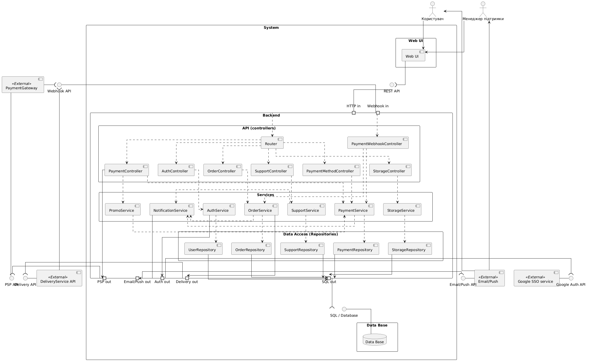

## Діаграма компонентів
@startuml "System Component Diagram"

skinparam componentStyle uml2
skinparam packageStyle rectangle
skinparam Linetype ortho

' Актори
actor "Користувач" as User
actor "Менеджер підтримки" as SupportManager

' ==========================================================
' ЗОВНІШНІ ІНТЕГРАЦІЇ (окремо, за межами системи)
' ==========================================================
component "Google SSO service" as GoogleSSO <<External>>
component "Email/Push" as EmailPushService <<External>>
component "DeliveryService API" as DeliveryService <<External>>
component "PaymentGateway" as PaymentGateway <<External>>

' ==========================================================
' ГОЛОВНА МЕЖА СИСТЕМИ
' ==========================================================
package "System" {

    ' Шар 1: Web UI (за межами Backend, але в System)
    package "Web UI" as WebUI_Layer {
        component "Web UI" as WebUI
    }

    ' Контракт на межі Backend (HTTP in)
    interface "REST API" as IRest

    ' Межі Backend
    package "Backend" {

        ' Порти на межі Backend
        portin "HTTP in" as HTTP_In
        portin "Webhook in" as Webhook_In
        portout "Auth out" as Auth_Out
        portout "PSP out" as PSP_Out
        portout "Email/Push out" as EmailPush_Out
        portout "Delivery out" as Delivery_Out
        portout "SQL out" as SQL_Out

        ' Шар 2: API (controllers)
        package "API (controllers)" as API_Package {
            component "Router" as Router
            component "AuthController" as AuthController
            component "PaymentMethodController" as PaymentMethodController
            component "PaymentController" as PaymentController
            component "PaymentWebhookController" as PaymentWebhookController
            component "StorageController" as StorageController
            component "OrderController" as OrderController
            component "SupportController" as SupportController
        }

        ' Шар 3: Services
        package "Services" as Services_Package {
            component "AuthService" as AuthService
            component "PaymentService" as PaymentService
            component "PromoService" as PromoService
            component "StorageService" as StorageService
            component "OrderService" as OrderService
            component "SupportService" as SupportService
            component "NotificationService" as NotificationService
        }

        ' Шар 4: Data Access (Repositories)
        package "Data Access (Repositories)" as DataAccess_Package {
            component "UserRepository" as UserRepository
            component "PaymentRepository" as PaymentRepository
            component "StorageRepository" as StorageRepository
            component "OrderRepository" as OrderRepository
            component "SupportRepository" as SupportRepository
        }
    }

    ' Контракт на базу даних (SQL out)
    interface "SQL / Database" as ISql

    ' Шар 5: Database (за межами Backend, але в System)
    package "Data Base" as DataBase_Layer {
        database "Data Base" as DB
    }
}

' ==========================================================
' КОНТРАКТИ (LOLLIPOPS) НА МЕЖІ СИСТЕМИ ДЛЯ ЗОВНІШНІХ СЕРВІСІВ
' ==========================================================
interface "Google Auth API" as IAuth
interface "Email/Push API" as IEmailPush
interface "Delivery API" as IDelivery
interface "PSP API" as IPSP
interface "Webhook API" as IWebhook

' ==========================================================
' ЗВ'ЯЗКИ ТА ЗАЛЕЖНОСТІ
' ==========================================================

' 1. Актори -> Web UI
User -down-> WebUI
SupportManager -down-> WebUI

' 2. Web UI -> Контракт REST API -> Порт HTTP in -> Router
WebUI -down-( IRest
IRest -down- HTTP_In
HTTP_In .down.> Router

' 3. Зовнішні сервіси (PaymentGateway, DeliveryService API) -> Webhook in -> PaymentWebhookController
PaymentGateway -right-( IWebhook
DeliveryService -left-( IWebhook
IWebhook -down- Webhook_In
Webhook_In .down.> PaymentWebhookController

' 4. Router -> Контролери (пунктирні лінії всередині шару)
Router .down.> AuthController
Router .down.> PaymentMethodController
Router .down.> PaymentController
Router .down.> StorageController
Router .down.> OrderController
Router .down.> SupportController

' 5. Контролери -> Сервіси (пунктирні лінії)
AuthController .down.> AuthService
PaymentMethodController .down.> PaymentService
PaymentController .down.> PaymentService
PaymentController .down.> PromoService
PaymentWebhookController .down.> PaymentService
PaymentWebhookController .down.> OrderService
StorageController .down.> StorageService
OrderController .down.> OrderService
SupportController .down.> SupportService

' 6. Залежності всередині шару Services (пунктирні лінії)
PromoService .right.> PaymentService
PaymentService .right.> NotificationService
OrderService .right.> NotificationService
SupportService .right.> NotificationService

' 7. Сервіси -> Репозиторії (пунктирні лінії)
AuthService .down.> UserRepository
PaymentService .down.> PaymentRepository
StorageService .down.> StorageRepository
OrderService .down.> OrderRepository
SupportService .down.> SupportRepository

' 8. Зовнішні інтеграції через вихідні порти (portout) та контракти Lollipop (суцільні лінії)
AuthService -left-> Auth_Out
Auth_Out -left-( IAuth
IAuth -left- GoogleSSO

NotificationService -right-> EmailPush_Out
EmailPush_Out -right-( IEmailPush
IEmailPush -right- EmailPushService

' Сповіщення акторів від зовнішнього сервісу Email/Push
EmailPushService -up-> SupportManager
EmailPushService -up-> User

OrderService -right-> Delivery_Out
Delivery_Out -right-( IDelivery
IDelivery -right- DeliveryService

PaymentController -left-> PSP_Out
PSP_Out -left-( IPSP
IPSP -left- PaymentGateway

' 9. Репозиторії -> порт SQL out -> контракт Lollipop -> База даних (суцільні лінії)
UserRepository -down-> SQL_Out
PaymentRepository -down-> SQL_Out
StorageRepository -down-> SQL_Out
OrderRepository -down-> SQL_Out
SupportRepository -down-> SQL_Out
SQL_Out -down-( ISql
ISql -down- DB

' ==========================================================
' ПРИХОВАНІ ЗВ'ЯЗКИ ДЛЯ УТРИМАННЯ ШАРІВ СТОПКОЮ
' ==========================================================
WebUI_Layer -[hidden]down-> API_Package
API_Package -[hidden]down-> Services_Package
Services_Package -[hidden]down-> DataAccess_Package
DataAccess_Package -[hidden]down-> DataBase_Layer

@enduml
